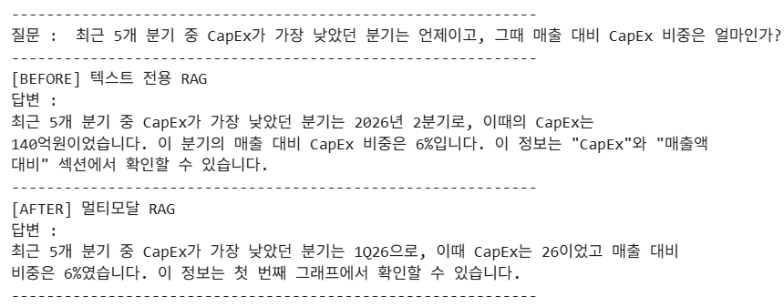

# Multimodal RAG Assignment

## 1. 문제 정의
- 대상 자료: 카카오 2026년 3분기 실적발표 자료 (15쪽, 2026.11.5 발표, 출처: https://kakaocorp.com/ir/referenceRoom/earningsAnnouncement). 저작권과 용량 문제로 PDF는 저장소에 포함하지 않았습니다. 위 링크에서 내려받아 `data/kakao_q3_2026.pdf`로 저장하세요.
- 왜 이 자료인가: 실적발표 자료는 핵심 수치가 본문이 아니라 슬라이드의 그래프(매출 구성, 뮤직, 미디어, 픽코마, CapEx, 인원 현황 등)와 표에 들어 있습니다. 그래서 텍스트만 추출하면 "CapEx가 가장 낮았던 분기는?" 같은 질문에 답할 수 없고, 그래프를 읽어야 답이 나옵니다. 멀티모달 RAG가 텍스트 RAG보다 나은지 비교하기에 적합하다고 생각해 선택했습니다.

## 2. 아키텍처
1. 파싱: `unstructured`의 `partition_pdf`로 텍스트·표·이미지 분리
2. 요약: 텍스트·표는 LLM, 이미지는 비전 모델로 요약
3. 저장·검색: 요약을 Chroma에 임베딩, 원본은 docstore에 같은 `doc_id`로 저장
4. 답변: 검색된 원본(이미지 포함)을 멀티모달 LLM에 넣어 답변 생성


## 3. 실행 방법
```bash
git clone https://github.com/HappYuBeen/Multimodal-Rag-Assignment.git
cd Multimodal-Rag-Assignment
python -m venv .venv
source .venv/bin/activate          # 윈도우: .venv\Scripts\activate
pip install --upgrade pip
pip install -r requirements.txt
cp .env.example .env               # 윈도우: copy .env.example .env
# .env 에 실제 OPENAI_API_KEY 입력
```
사전 설치 필요: Poppler (`pdftoppm`), Tesseract (`tesseract`). 설치 후 터미널을 재시작하세요.

노트북 `notebooks/Multi_modal_RAG.ipynb`를 위에서부터 순서대로 실행합니다. 노트북은 `src/`의 함수를 불러옵니다.

## 프로젝트 구조
```
Multimodal-Rag-Assignment/
├── .venv/                     # 가상환경 (Git 제외)
├── .env                       # API 키 (Git 제외)
├── .env.example               # 키 없는 템플릿
├── .gitignore
├── requirements.txt           # 의존성 목록
├── requirements.lock.txt      # 버전 고정 파일
├── README.md
├── data/
│   ├── kakao_q3_2026.pdf      # 원본 PDF (Git 제외)
│   └── figures/               # 추출된 이미지 (Git 제외)
├── docs/                      # README용 이미지 (다이어그램, Before/After 캡처)
├── notebooks/
│   └── Multi_modal_RAG.ipynb  # 실습 노트북
└── src/
    ├── extract.py             # PDF 파싱 함수
    ├── summarize.py           # 요약 체인
    └── retriever.py           # 다중 벡터 검색기
```

## 4. 기술 선택 근거
- 모델: gpt-4o-mini
텍스트와 표, 그림 요약부터 최종 답변까지 모두 gpt-4o-mini 모델을 사용했습니다. 이미지 입력도 지원하기 때문에 그래프를 직접 분석하고 요약할 수 있습니다. 또한 그림이 14장 포함되어 있어 여러 번 호출해야 하는 점을 고려했을 때 비용 부담도 크지 않다고 판단했습니다. 요약 결과가 일정하게 유지되도록 temperature는 0으로 설정했으며, 임베딩 모델은 text-embedding-3-small을 사용했습니다.

- 청크 크기: 최대 4000자 (3800자 넘으면 새 청크, 2000자 미만은 합침)
실적발표 자료는 슬라이드마다 내용이 짧게 나뉘어 있어 단순히 글자 수를 기준으로 자르면 제목과 표, 숫자 정보가 서로 떨어질 수 있습니다. 이를 방지하기 위해 제목을 기준으로 내용을 묶는 by_title 방식을 적용했습니다. 또한 2000자 미만의 작은 청크는 주변 내용과 합쳐 하나의 주제가 최대한 한 청크 안에 들어가도록 했습니다.

- 프롬프트 언어: 지시문은 영어, 결과는 한국어
요약 프롬프트는 영어로 작성하고, 결과는 한국어로 출력하도록 설정했습니다. 검색과 답변 모두 한국어로 진행하기 때문에 요약 결과도 한국어로 통일했습니다. 그림 요약에는 그래프의 축 이름과 값의 범위, 전체적인 추세를 포함하도록 조건을 추가했습니다. 그래프를 단순히 설명하는 데 그치지 않고 실제 수치 정보도 요약에 반영하기 위해서입니다. 답변 프롬프트는 한국어로 작성했으며, 자료에 없는 내용은 모른다고 답하고 임의로 계산하거나 추정하지 않도록 했습니다. 이를 통해 근거가 부족한 답변이나 잘못된 수치가 생성되는 것을 줄이고자 했습니다.

- 검색 구조: 요약으로 검색하고 원본으로 답변
그림이나 표는 원본 형태 그대로 임베딩하기 어렵기 때문에 요약한 내용을 Chroma에 저장해 검색에 활용했습니다. 원본 데이터는 docstore에 별도로 보관하고, 요약 데이터와 동일한 doc_id를 사용해 서로 연결했습니다. 먼저 요약 데이터를 검색해 질문과 관련된 내용을 찾고, 검색된 결과와 연결된 원본 자료를 불러오도록 했습니다. 최종 답변을 생성할 때는 요약 내용만 사용하는 것이 아니라 원본 자료와 그림까지 모델에 전달하도록 했습니다. 그래프에 포함된 세부 수치나 표의 내용을 직접 확인하고 답변할 수 있도록 구성했습니다.

## 5. Before / After 비교


| 질문 | 텍스트 RAG 답변 | 멀티모달 RAG 답변 | 차이 |
| --- | --- | --- | --- |
| CapEx가 가장 낮았던 분기와 비중은? | 2Q26, 36억원 (틀림) | 1Q26, 6% (분기·비중 맞음, 금액 26은 틀림) | 그래프 안의 값은 텍스트에 없어서 텍스트 RAG는 분기를 못 맞혔고, 멀티모달은 그래프를 보고 맞힘 |
| 픽코마 매출 추세는? | 감소, 148→126 수치 모두 맞음 | 결론은 감소(맞음), 근거 수치는 틀림 | 본문에 수치가 있는 질문은 텍스트 RAG가 더 정확했음 |


## 6. 질의응답 5건
| 질문 | 답변 | 근거가 된 원본 종류 (텍스트/표/이미지) |
| --- | --- | --- |
| CapEx가 가장 낮았던 분기와 매출 대비 비중은? | 1Q26, 비중 6%. CapEx 금액은 26이라고 답했으나 정답은 118십억원 (무형자산만 읽음) | 이미지 |
| 뮤직 매출이 가장 컸던/작았던 분기는? | 4Q25(1,200), 1Q26(789)이라고 답함. 정답은 3Q25(565), 1Q26(485)로 틀림 (다른 그래프를 읽음) | 이미지 |
| 픽코마 매출은 증가 추세인가 감소 추세인가? | 결론은 "감소"로 맞지만 근거 수치(1,060~1,235)는 틀림 (정답 148→126) | 이미지 |
| 미디어 매출이 가장 컸던 분기는? | 4Q25(2,042)라고 답함. 정답은 3Q26(143)으로 틀림 | 이미지 |
| 전체 인원은 증가 추세인가 감소 추세인가? | 감소. 16,189→15,856→14,090→14,046→14,037로 5개 값 모두 정확 | 이미지, 텍스트/표 |


## 7. 한계
- 그래프 제목이 잘려 엉뚱한 그래프를 참고하는 문제: 추출된 이미지에 제목이나 범례가 포함되지 않은 경우가 있어, 이미지 요약만으로는 어떤 지표를 나타내는 그래프인지 파악하기 어려웠습니다. 실제로 뮤직·미디어 관련 질문에서 해당 그래프가 아닌 다른 그래프의 수치인 1,200과 2,042를 가져와 답변했습니다.
- 막대 안의 세부 값을 전체 금액으로 잘못 해석하는 문제: CapEx 질문에서는 분기(1Q26)와 비중(6%)은 정확하게 답했지만, 금액은 무형자산 26만 읽어 전체 CapEx 금액으로 답했습니다. 실제 금액은 유형자산 92와 무형자산 26을 합한 118십억원입니다.
- 단위 혼동: 원본 자료의 단위는 십억원이지만, 답변에서는 억원으로 표기하거나 단위를 생략하는 경우가 있었습니다. 프롬프트에 단위 관련 조건을 추가했지만 모든 오류를 막지는 못했습니다.
- 일부 그래프 누락: 그래프가 벡터 형태로 만들어진 경우 partition_pdf에서 이미지로 추출되지 않는 문제가 있었습니다. 이로 인해 일부 슬라이드의 그래프는 요약 과정에서 제외되었습니다.
- 실행할 때마다 답변이 달라지는 문제: 동일한 질문을 여러 번 실행했을 때 검색되는 그래프나 최종 답변이 달라지는 경우가 있었습니다.
- 자료 자체의 한계: 사용한 자료의 재무 수치는 감사 전 추정치이기 때문에 정확한 확정 수치로 보기 어렵습니다. 또한 픽코마처럼 텍스트 RAG가 더 정확한 결과를 보인 질문도 있어 모든 질문에서 멀티모달 RAG가 더 좋은 결과를 내는 것은 아니었습니다.

개선하고 싶은 점
- 그림을 요약할 때 해당 슬라이드의 제목도 함께 전달해 그래프가 어떤 지표를 나타내는지 파악할 수 있도록 개선
- 검색된 이미지가 실제 질문과 관련 있는 자료인지 확인하는 과정 추가
- 숫자와 금액을 묻는 질문은 이미지뿐만 아니라 표나 텍스트 원본과도 비교해 정확성 높이기
