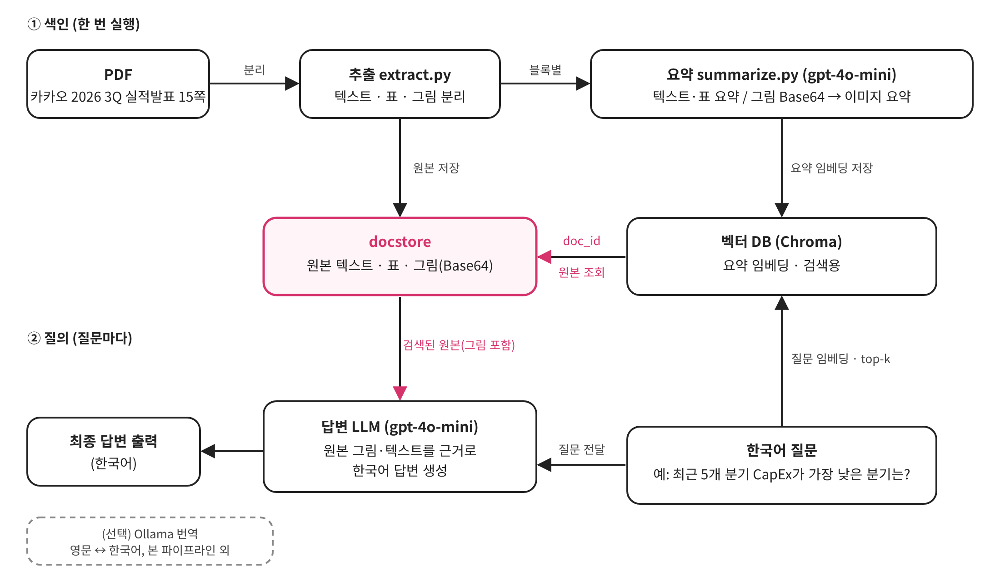

# Multimodal RAG Assignment

## 1. 문제 정의
- 대상 자료: 카카오 2026년 3분기 실적발표 자료 (15쪽, 2026.11.5 발표, 출처: https://kakaocorp.com/ir/referenceRoom/earningsAnnouncement). 저작권과 용량 문제로 PDF는 저장소에 포함하지 않았습니다. 위 링크에서 내려받아 `data/kakao_q3_2026.pdf`로 저장하세요.
- 왜 이 자료인가: (그래프·표가 어디에 있고 어떤 질문이 가능한지)

## 2. 아키텍처
1. 파싱: `unstructured`의 `partition_pdf`로 텍스트·표·이미지 분리
2. 요약: 텍스트·표는 LLM, 이미지는 비전 모델로 요약
3. 저장·검색: 요약을 Chroma에 임베딩, 원본은 docstore에 같은 `doc_id`로 저장
4. 답변: 검색된 원본(이미지 포함)을 멀티모달 LLM에 넣어 답변 생성



(직접 작도한 다이어그램을 `docs/architecture.png`로 저장. Mermaid로 그렸다면 아래에 코드 블록으로 넣어도 됨. 교안 그림 복사 금지)

## 3. 실행 방법
```bash
git clone https://github.com/HappYuBeen/Multimodal-Rag-Assignment.git
cd Multimodal-Rag-Assignment
python -m venv .venv
source .venv/bin/activate          # 윈도우: .venv\Scripts\activate
pip install --upgrade pip
pip install -r requirements.txt
cp .env.example .env               # 윈도우: copy .env.example .env
# .env 에 실제 OPENAI_API_KEY 입력
```
사전 설치 필요: Poppler (`pdftoppm`), Tesseract (`tesseract`). 설치 후 터미널을 재시작하세요.

노트북 `notebooks/Multi_modal_RAG.ipynb`를 위에서부터 순서대로 실행합니다. 노트북은 `src/`의 함수를 불러옵니다.

## 프로젝트 구조
```
Multimodal-Rag-Assignment/
├── .venv/                     # 가상환경 (Git 제외)
├── .env                       # API 키 (Git 제외)
├── .env.example               # 키 없는 템플릿
├── .gitignore
├── requirements.txt           # 의존성 목록
├── requirements.lock.txt      # 버전 고정 파일
├── README.md
├── data/
│   ├── kakao_q3_2026.pdf      # 원본 PDF (Git 제외)
│   └── figures/               # 추출된 이미지 (Git 제외)
├── docs/                      # README용 이미지 (다이어그램, Before/After 캡처)
├── notebooks/
│   └── Multi_modal_RAG.ipynb  # 실습 노트북
└── src/
    ├── extract.py             # PDF 파싱 함수
    ├── summarize.py           # 요약 체인
    └── retriever.py           # 다중 벡터 검색기
```

## 4. 기술 선택 근거
- 모델 / 청크 크기 / 프롬프트 언어 선택 이유: (작성)

## 5. Before / After 비교
캡처 이미지는 `docs/` 폴더에 저장합니다. (`data/figures/`는 `.gitignore` 대상이라 GitHub에 올라가지 않습니다)


| 질문 | 텍스트 RAG 답변 | 멀티모달 RAG 답변 | 차이 |
| --- | --- | --- | --- |
| | | | |

## 6. 질의응답 5건
| 질문 | 답변 | 근거가 된 원본 종류 (텍스트/표/이미지) |
| --- | --- | --- |
| 1 | | |
| 2 | | |
| 3 | | |
| 4 | | |
| 5 | | |

## 7. 한계
- (작성)
